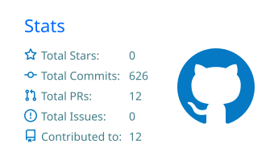
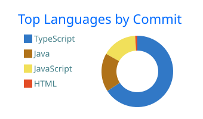

<!-- Header -->
<p align="center">
  
</p>

<p align="center">
  
</p>

<p align="center">
  <a href="https://www.linkedin.com/in/paramveer-singh-3623a9183"></a>
  <a href="mailto:paramsinghkhattra@gmail.com"></a>
  <a href="https://paramveer-singh.netlify.app"></a>
  
</p>

---

### About me

I build real-time, data-heavy products end to end: **Java and Spring Boot** microservices, **Kafka and Flink** pipelines, and **React and Next.js** interfaces. Over 10+ years I've delivered for Etisalat (e&), Touchnote, Barclays, BCBSMA, ADIB and Expedia, across telecom, banking, insurance and e-commerce.

```java
public class Paramveer extends SeniorEngineer {
    String   role     = "Senior Full Stack Engineer @ Etisalat (e&)";
    String   location = "Dubai, UAE";
    int      years    = 10;
    String   focus    = "Real-time data platforms";
    String[] backend  = {"Java", "Spring Boot", "Spring Cloud", "Node.js"};
    String[] data     = {"Kafka", "Flink", "NiFi", "Redis", "Elasticsearch"};
    String[] frontend = {"React", "Next.js", "TypeScript", "Angular"};
    String   openTo   = "Senior full-stack and backend roles";
}
```

---

### Highlights

<table>
  <tr>
    <td width="50%" valign="top">
      <h4>Real-Time Campaign Platform</h4>
      <sub>Etisalat (e&)</sub><br/><br/>
      Self-service platform for streaming and scheduled campaigns.<br/>
      <b>4M records/sec</b> · <b>99.99% uptime</b><br/><br/>
      <sub><code>Spring Boot</code> <code>Kafka</code> <code>Flink</code> <code>NiFi</code> <code>Redis</code> <code>React</code></sub>
    </td>
    <td width="50%" valign="top">
      <h4>Pipeline Builder</h4>
      <sub>Etisalat (e&)</sub><br/><br/>
      Metadata-driven UI for configuring data pipelines.<br/>
      <b>60% faster setup</b> · <b>17 micro-frontends</b><br/><br/>
      <sub><code>Next.js 15</code> <code>React 19</code> <code>TypeScript</code> <code>Redux Toolkit</code></sub>
    </td>
  </tr>
  <tr>
    <td width="50%" valign="top">
      <h4>Real-Time Traffic Dashboard</h4>
      <sub>Abu Dhabi Dept. of Municipalities & Transport</sub><br/><br/>
      City-wide traffic telemetry, event logs and KPIs.<br/>
      <b>Sub-second refresh</b><br/><br/>
      <sub><code>Spring Boot</code> <code>Kafka Streams</code> <code>WebSockets</code> <code>D3.js</code></sub>
    </td>
    <td width="50%" valign="top">
      <h4>E-commerce Platform Redesign</h4>
      <sub>Touchnote</sub><br/><br/>
      SEO-first storefront rebuild with Shopify integration.<br/>
      <b>Lighthouse 90+</b> · <b>+7% conversions MoM</b><br/><br/>
      <sub><code>Next.js</code> <code>React</code> <code>Node.js</code> <code>Shopify</code></sub>
    </td>
  </tr>
  <tr>
    <td width="50%" valign="top">
      <h4>Digital Banking Services</h4>
      <sub>Barclays (via IBM)</sub><br/><br/>
      Java services for authentication, accounts and payments.<br/>
      <b>Millions of daily transactions</b> · <b>20% faster APIs</b><br/><br/>
      <sub><code>Java</code> <code>Spring Boot</code> <code>REST</code> <code>SOAP</code> <code>Oracle</code></sub>
    </td>
    <td width="50%" valign="top">
      <h4>Agents & Console Portal</h4>
      <sub>Expedia Group (freelance)</sub><br/><br/>
      Agent onboarding, routing, telephony and omnichannel workflows.<br/>
      <b>Thousands of agents</b> · <b>2-year engagement</b><br/><br/>
      <sub><code>React</code> <code>TypeScript</code> <code>Redux Toolkit</code></sub>
    </td>
  </tr>
</table>

<sub>Client and employer code is private. The repositories pinned below are my own.</sub>

---

### Experience

| Period | Role | Company |
|---|---|---|
| 2024 – Present | Senior Full Stack Developer | **Etisalat (e&)**, Dubai |
| 2023 – 2025 | Freelance Full Stack Developer | **Expedia Group**, **KingCaller AI** |
| 2020 – 2024 | Senior Full Stack Developer | **Touchnote** (UK) |
| 2016 – 2020 | Full Stack Developer | **IBM**: Barclays, BCBSMA, ADIB |

---

### Tech stack

**Backend**<br/>


**Frontend**<br/>


**Data and messaging**<br/>


**Cloud and DevOps**<br/>


---

### GitHub activity

<p align="center">
  
  
</p>
<p align="center">
  
</p>

---

<p align="center">
  <b>Open to senior full-stack and backend roles.</b><br/>
  Email <a href="mailto:paramsinghkhattra@gmail.com">paramsinghkhattra@gmail.com</a> or connect on <a href="https://www.linkedin.com/in/paramveer-singh-3623a9183">LinkedIn</a>.
</p>


